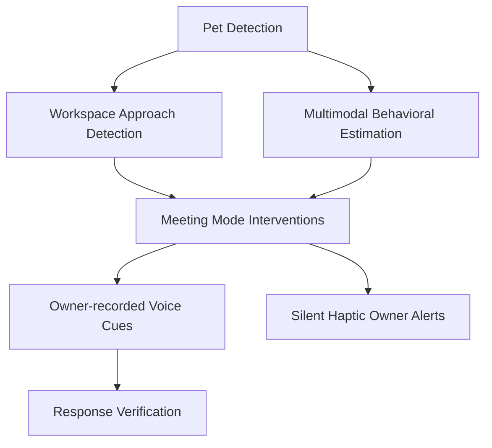

# Feature Research

**Domain:** Offline-first, on-device AI for pet interruption prevention
**Researched:** 2026-10-05
**Confidence:** HIGH

## Feature Landscape

### Table Stakes (Users Expect These)

Features users assume exist. Missing these = product feels incomplete.

| Feature | Why Expected | Complexity | Notes |
|---------|--------------|------------|-------|
| Reliable Pet Detection | Needs to accurately identify a dog vs. a person or object. | MEDIUM | Standard edge AI models (EfficientDet-Lite) handle this well. |
| Owner-recorded Voice Cues | Generic synthetic voices don't calm dogs; owners expect to use their own voice/commands. | LOW | Just requires local audio recording and playback capabilities. |
| Offline & Private Operation | Users want a camera running in their workspace to not stream to the cloud. | HIGH | Requires all AI processing (vision + audio) to run on-device (e.g., NPU/CPU). |
| Meeting Mode Toggle | System must be easily enabled/disabled so it doesn't run 24/7. | LOW | Simple UI toggle; could be integrated with calendar later (v2). |

### Differentiators (Competitive Advantage)

Features that set the product apart. Not required, but valuable.

| Feature | Value Proposition | Complexity | Notes |
|---------|-------------------|------------|-------|
| Workspace Approach Detection | Intervenes *before* the interruption happens (proactive), rather than just reacting to the dog existing. | HIGH | Requires spatial bounding box analysis and movement vectors. |
| Multimodal Behavioral Estimation | Distinguishes between a calm, sleeping dog (no action needed) and an attention-seeking dog. | HIGH | Combines visual pose/movement with audio cues (e.g., whining). |
| Response Verification | System checks if the cue worked and can play a secondary cue if ignored. | MEDIUM | Creates a closed-loop system rather than "fire and forget". |
| Silent Haptic Owner Alerts | Keeps the owner informed of interventions without making noise on the meeting audio. | LOW | Uses standard phone vibration APIs. |
| Capped Interventions (Max 2) | Prevents the system from repeatedly spamming the dog with cues if they aren't responding. | LOW | Simple state machine rule, avoids stressing the dog. |

### Anti-Features (Commonly Requested, Often Problematic)

Features that seem good but create problems.

| Feature | Why Requested | Why Problematic | Alternative |
|---------|---------------|-----------------|-------------|
| Live Video Streaming | People are used to traditional "pet cameras" and want to check in. | Breaks offline-first privacy; out of scope for a dedicated meeting assistant. | Local session text logging of interventions instead. |
| Cloud AI Analytics | "Better" AI models or long-term behavior charting. | Ruins the privacy guarantee, introduces latency, requires subscription. | Keep processing strictly on-device using edge models. |
| Aversive Deterrents (Ultrasonic) | Quickest way to stop a dog. | Unethical, causes anxiety, can worsen behavior long-term. | Positive redirection via familiar owner voice. |
| Emotion Detection | Owners want to know if the dog is "sad" or "anxious". | Unreliable, anthropomorphic, and unnecessary for simple redirection. | Stick to observable behavioral states (e.g., ACTIVE, VOCALIZING). |

## Feature Dependencies

### Dependency Notes

- **Workspace Approach Detection requires Pet Detection:** You can't track approach if you can't reliably detect the pet's bounding box.
- **Multimodal Behavioral Estimation enhances Pet Detection:** Combining visual state with audio (whining/barking) makes the trigger decision much more accurate.
- **Response Verification requires Owner-recorded Voice Cues:** The system must observe the dog's state *after* playing the cue to verify response.

## MVP Definition

### Launch With (v1)

Minimum viable product — what's needed to validate the concept.

- [ ] Meeting Mode Toggle — Core trigger for the system.
- [ ] Pet Detection (Visual) — Basic bounding box detection.
- [ ] Workspace Approach Detection — Intercept dog before they jump on the owner.
- [ ] Owner-recorded Voice Cues — Core intervention mechanism.
- [ ] Offline & Private Operation — Must work in Airplane mode to prove value.
- [ ] Capped Interventions — Hard stop after 2 cues.

### Add After Validation (v1.x)

Features to add once core is working.

- [ ] Multimodal Behavioral Estimation — Add audio context (whining, panting) to improve accuracy.
- [ ] Response Verification — Check if dog actually backed off.
- [ ] Silent Haptic Owner Alerts — So owner knows an intervention fired.
- [ ] Local Session Logging — Basic text history of what happened.

### Future Consideration (v2+)

Features to defer until product-market fit is established.

- [ ] Automatic Meeting Detection — Hook into calendar or microphone state.
- [ ] Advanced TDOA/Audio Localization — Pinpoint exactly where the dog is based on sound.
- [ ] Treat Dispenser Integration — Connect locally (e.g. via Bluetooth/Zigbee) to reward good behavior.

## Feature Prioritization Matrix

| Feature | User Value | Implementation Cost | Priority |
|---------|------------|---------------------|----------|
| Pet Detection | HIGH | MEDIUM | P1 |
| Owner-recorded Cues | HIGH | LOW | P1 |
| Offline Operation | HIGH | HIGH | P1 |
| Workspace Approach | HIGH | MEDIUM | P1 |
| Capped Interventions | MEDIUM | LOW | P1 |
| Haptic Alerts | MEDIUM | LOW | P2 |
| Response Verification| HIGH | MEDIUM | P2 |
| Behavioral Estimation| HIGH | HIGH | P2 |
| Session Logging | LOW | LOW | P3 |
| Auto Meeting Detect | MEDIUM | HIGH | P3 |

**Priority key:**
- P1: Must have for launch
- P2: Should have, add when possible
- P3: Nice to have, future consideration

## Competitor Feature Analysis

| Feature | Eufy Pet Camera | Aqara G3 | QuietPaws (Our Approach) |
|---------|-----------------|----------|--------------------------|
| Primary Use Case | General Pet Monitoring | Smart Home Hub / Security | **Dedicated Meeting Protector** |
| AI Processing | On-device | On-device | **On-device (Mobile CPU/NPU)** |
| Hardware Required | Expensive Custom Camera | Custom Camera | **Uses Existing Smartphone** |
| Intervention | Manual via app or treat tossing | Manual / Basic Automations | **Automated Context-Aware Audio Cues** |
| Connectivity | Wi-Fi (Local option) | Wi-Fi (Local option) | **100% Offline (Airplane Mode)** |

## Sources

- Project Context (PROJECT.md)
- Market analysis of local-first smart pet monitors (Eufy, Aqara, Tapo)
- Dog training principles (Positive reinforcement, avoiding aversive methods)
---
*Feature research for: Offline-first, on-device AI for pet interruption prevention*
*Researched: 2026-10-05*
